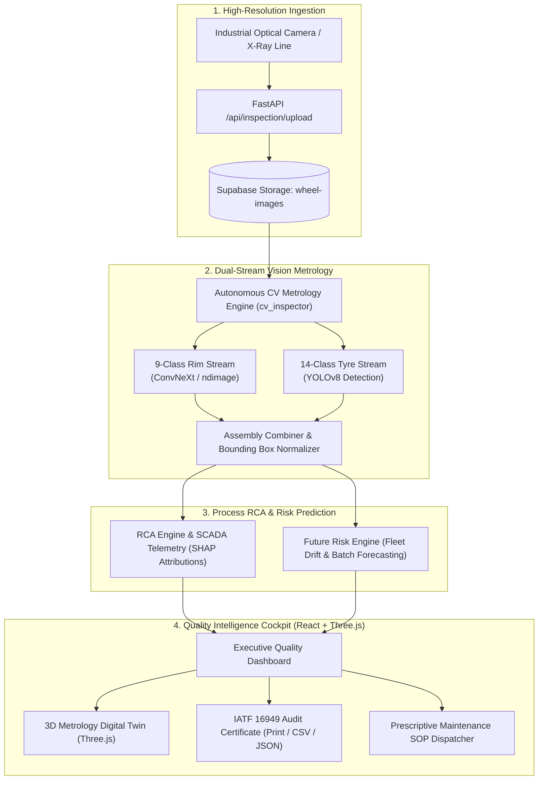

# AGNIJNANA — Autonomous Automotive Wheel Quality Intelligence

[](https://fastapi.tiangolo.com)
[](https://react.dev)
[](https://threejs.org)
[](https://vitejs.dev)
[](https://supabase.com)
[](https://render.com)
[](https://vercel.com)
[](https://python.org)
[](https://github.com/Ganesh40292/Agnijnana)

> **SINGULARITY 2026 — Track 3: Autonomous Quality Metrology & Industrial Defect Intelligence**  
> An enterprise-grade, end-to-end industrial quality assurance cockpit for cast aluminium alloy automotive wheel assemblies and radial tyres. Combines computer vision metrology, explainable physics-guided root-cause telemetry, and predictive drift forecasting to achieve zero-defect manufacturing.

---

## 📌 Table of Contents
1. [Executive Summary](#-executive-summary)
2. [Key Capabilities](#-key-capabilities)
3. [System Architecture](#-system-architecture)
4. [Defect Taxonomies & Metrology Classes](#-defect-taxonomies--metrology-classes)
5. [Tech Stack](#-tech-stack)
6. [Getting Started & Installation (Clone Method)](#-getting-started--installation-clone-method)
7. [Cloud Deployment Architecture](#-cloud-deployment-architecture)
   - [Supabase Setup](#1-database--storage-supabase)
   - [Render Setup (Backend)](#2-backend-render)
   - [Vercel Setup (Frontend)](#3-frontend-vercel)
8. [API Endpoints Reference](#-api-endpoints-reference)
9. [Project Directory Structure](#-project-directory-structure)
10. [Team & Contributions](#-team--contributions)
11. [License & Compliance](#-license--compliance)

---

## 🚀 Executive Summary

Aluminium alloy wheels are safety-critical structural automotive components manufactured through **Low-Pressure Die Casting (LPDC)**, **High-Pressure Die Casting (HPDC)**, heat treatment (T6), CNC precision machining, and robotic finishing. Minor sub-surface gas porosity, shrinkage fissures, blow holes, or bead-seat cracks can cause sudden air loss or catastrophic wheel structural failure under dynamic radial fatigue conditions (**SAE J328** / **ISO 3006**).

**AGNIJNANA** eliminates manual visual sampling bottlenecks by providing an autonomous, closed-loop quality cockpit:
- **Instant Metrology (<34 ms)**: Autonomous vision pipeline segments anomalies, computes millimetric coordinates, bounding boxes, defect area ($mm^2$), and estimated flaw depth.
- **Explainable Root Cause Analysis (RCA)**: Correlates detected visual flaws with real-time SCADA/PLC telemetry (die temperature, injection pressure, plunger velocity, degassing flow).
- **Predictive Risk Forecasting**: Forewarns plant engineers which casting cell or upcoming heat batch is trending toward quality degradation before scrap propagates.
- **Prescriptive Maintenance & Compliance**: Auto-generates standard operating procedure (SOP) work orders and downloadable **IATF 16949 / ISO 9001** inspection certificates with digital cryptographic verification.

---

## ✨ Key Capabilities

| Module | Functionality |
| :--- | :--- |
| **Dual-Stream Vision Metrology** | Deterministic image processing + deep learning identifying 9 rim flaw categories and 14 radial tyre defect classes. |
| **Interactive 3D Digital Twin** | Real-time WebGL/Three.js 3D wheel inspection view with dynamic camera tracks, lighting angles, and wireframe metrology grids. |
| **Root Cause Analysis (RCA)** | SCADA parameter telemetry attribution powered by SHAP-style explainability factors (e.g., plunger shot stability vs. degassing uniformity). |
| **Predictive Fleet Risk Forecaster** | 5-cycle escalation trajectory ranking equipment health, predicting next batch defect probabilities and cycles remaining to maintenance. |
| **Prescriptive SOP Work Orders** | Automated disposition dispatcher classifying items into `LINE_RELEASE`, `ROBOTIC_REWORK`, or `SCRAP_QUARANTINE`. |
| **IATF 16949 Audit Generator** | One-click modal generating printable compliance certificates with tamper-proof SHA-256 signatures, CSV exports, and audit JSON records. |
| **Authentication & Profile Hub** | Streamlined user sign-in/registration, Google OAuth integration, interactive profile manager, and legal compliance workflows. |

---

## 🏛 System Architecture



---

## 🔍 Defect Taxonomies & Metrology Classes

### 1. Aluminium Alloy Rim Classes (9 Categories)
- **`defect_free`**: Flawless alloy wheel conforming to SAE J328 fatigue limits.
- **`scratch`**: Superficial tooling or handling abrasions on cosmetic face.
- **`blow_hole`**: Entrapped gas pockets exposed during CNC diamond machining.
- **`incomplete_welding`**: Flange seam fusion discontinuity.
- **`bent_rim`**: Geometric rim run-out deviation exceeding radial tolerances.
- **`crack`**: Structural fissure propagating from spoke fillet stress concentrations.
- **`porosity`**: Hydrogen micro-cavity clusters from insufficient melt degassing.
- **`scuff`**: Pallet conveyor contact markings on outer flange bead seat.
- **`paint_damage`**: Basecoat or clearcoat finish adhesion defects.

### 2. Radial Tyre Classes (14 Categories)
`Generic_Defect`, `Bulge`, `Cracks`, `Flat_Spots`, `Good`, `Pitting`, `Puncture`, `Bad_Tire`, `Bald_Tire`, `Normal_Tire`, `Xray_Open`, `Cord_Defect`, `Impurity`, `Belt_Defect`.

---

## 💻 Tech Stack

- **Frontend**: React 18, Vite 5, Three.js, React-Three-Fiber, Lucide Icons, Pure CSS3 Design Tokens.
- **Backend**: Python 3.10+ / 3.11+, FastAPI, Pydantic v2, Uvicorn, Pillow, NumPy, SciPy.
- **Database & Storage**: Supabase (PostgreSQL 15), Supabase Storage Bucket (`wheel-images`).
- **Cloud Deployment**: Render (Backend Web Service), Vercel (Frontend Single Page App).
- **Standards & Compliance**: SAE J328 Radial Fatigue, IATF 16949 Automotive Quality Management, ISO 9001:2015.

---

## 🛠 Getting Started & Installation (Clone Method)

### Step 1: Clone the Repository
Open your terminal and clone the repository:
```bash
git clone https://github.com/Ganesh40292/Agnijnana.git
cd Agnijnana
```

---

### Step 2: Backend Setup (FastAPI)

1. Navigate to the backend directory:
   ```bash
   cd automotive-wheel-quality-intelligence/backend
   ```

2. Create and activate a Python virtual environment:
   - **Windows:**
     ```powershell
     python -m venv venv
     .\venv\Scripts\activate
     ```
   - **macOS / Linux:**
     ```bash
     python3 -m venv venv
     source venv/bin/activate
     ```

3. Install required Python packages:
   ```bash
   pip install -r requirements.txt
   ```

4. Configure environment variables (Optional for local testing; default fallbacks work out of the box):
   ```bash
   cp .env.example .env
   ```

5. Run the FastAPI development server:
   ```bash
   uvicorn app.main:app --reload --port 8000
   ```
   - API Server: `http://localhost:8000`
   - Interactive Swagger Docs: `http://localhost:8000/docs`

---

### Step 3: Frontend Setup (React + Vite)

1. Open a new terminal window and navigate to the frontend directory:
   ```bash
   cd automotive-wheel-quality-intelligence/frontend
   ```

2. Install npm dependencies:
   ```bash
   npm install
   ```

3. Start the Vite development server:
   ```bash
   npm run dev
   ```
   - Frontend Application: `http://localhost:5188` (or port indicated in the terminal)

---

### Step 4: Running Test Suites

Run the backend automated verification tests:
```bash
cd automotive-wheel-quality-intelligence
py -m pytest backend/tests
```

Run frontend production build verification:
```bash
cd automotive-wheel-quality-intelligence/frontend
npm run build
```

---

## ☁ Cloud Deployment Architecture

### 1. Database & Storage (Supabase)
1. Log into your [Supabase Console](https://supabase.com).
2. Create a new project.
3. Open the **SQL Editor** and run the database initialization script from:
   [`automotive-wheel-quality-intelligence/database/schema/schema.sql`](./automotive-wheel-quality-intelligence/database/schema/schema.sql)
4. Open the **Storage** section and create a bucket named:
   ```text
   wheel-images
   ```
5. Copy your **Project URL** and **API Keys** from **Project Settings → API**.

---

### 2. Backend (Render)
A production Blueprint is already included at [`render.yaml`](./render.yaml).

**Option A (Automatic Blueprint):**
1. In [Render](https://render.com), select **New +** → **Blueprint**.
2. Connect your `Ganesh40292/Agnijnana` repository.
3. Render automatically provisions the web service using `render.yaml`.

**Option B (Manual Web Service):**
1. **Name**: `automotive-quality-backend`
2. **Root Directory**: `automotive-wheel-quality-intelligence/backend`
3. **Build Command**: `pip install -r requirements.txt`
4. **Start Command**: `uvicorn app.main:app --host 0.0.0.0 --port $PORT`
5. **Environment Variables**:
   - `PYTHON_VERSION`: `3.11.9`
   - `ENVIRONMENT`: `production`
   - `CORS_ORIGINS`: `*`
   - `SUPABASE_URL`: *(your Supabase project URL)*
   - `SUPABASE_KEY`: *(your Supabase service role key)*
   - `SUPABASE_BUCKET`: `wheel-images`

---

### 3. Frontend (Vercel)
A client-side rewrite configuration is ready in [`vercel.json`](./automotive-wheel-quality-intelligence/frontend/vercel.json).

1. Log into [Vercel](https://vercel.com) and click **Add New...** → **Project**.
2. Import the `Ganesh40292/Agnijnana` GitHub repository.
3. Set **Root Directory** to:
   ```text
   automotive-wheel-quality-intelligence/frontend
   ```
4. Framework Preset: **Vite**.
5. Add Environment Variable:
   - **`VITE_API_BASE_URL`**: `https://automotive-quality-backend.onrender.com` *(your live Render backend URL)*
6. Click **Deploy**.

---

## 📡 API Endpoints Reference

| Method | Endpoint | Description |
| :--- | :--- | :--- |
| `GET` | `/health` | Service health status and version identifier. |
| `POST` | `/api/inspection/upload` | Ingests wheel image to local storage and syncs to Supabase storage. |
| `POST` | `/api/inspection/inspect` | Executes CV metrology, defect localization, severity, RCA, and risk. |
| `GET` | `/api/inspection/{wheel_id}` | Retrieves historical inspection output for a specific serial ID. |
| `GET` | `/api/defects` | Queries detected defects with optional batch and severity filtering. |
| `GET` | `/api/alerts` | Fetches active high-priority production line and quality alerts. |
| `GET` | `/api/risk` | Returns consolidated plant risk summary across all casting lines. |
| `GET` | `/api/future-risk/machines` | Ranks casting machine fleet by predicted defect probability. |
| `GET` | `/api/future-risk/batches` | Ranks production heats and batches by forecasted scrap rate. |
| `GET` | `/api/future-risk/upcoming-batches` | Predicts risk scores for scheduled upcoming production batches. |
| `GET` | `/api/machines` | Fetches live machine status, telemetry gauges, and cycle times. |
| `GET` | `/api/batches` | Retrieves batch status, scrap rates, and inspection counts. |

---

## 📂 Project Directory Structure

```text
Agnijnana/
├── .gitignore                                      # Comprehensive root exclusions
├── README.md                                       # Master project documentation
├── render.yaml                                     # One-click Render Blueprint definition
└── automotive-wheel-quality-intelligence/          # Main application package
    ├── render.yaml                                 # Microservice render blueprint
    ├── docker-compose.yml                          # Local container stack
    ├── database/
    │   └── schema/schema.sql                       # Complete PostgreSQL DDL schema
    ├── backend/                                    # FastAPI Backend
    │   ├── requirements.txt                        # Python dependencies
    │   ├── Procfile                                # Heroku/PaaS process launcher
    │   ├── app/
    │   │   ├── main.py                             # API router registration & CORS
    │   │   ├── api/                                # Modular API endpoints
    │   │   ├── schemas/quality.py                  # Pydantic AI contract models
    │   │   └── services/
    │   │       ├── cv_inspection_engine.py         # Autonomous CV Metrology
    │   │       ├── future_risk_engine.py           # Predictive Machine Risk Forecasting
    │   │       ├── root_cause_engine.py            # SCADA Parameter Attribution
    │   │       └── hybrid_inspection.py            # YOLO + CNN pipeline orchestration
    │   └── tests/                                  # Pytest automated test suite
    └── frontend/                                   # React + Vite Frontend
        ├── index.html                              # Entry HTML
        ├── package.json                            # Node.js dependencies
        ├── vercel.json                             # Vercel SPA routing
        ├── public/_redirects                       # Netlify SPA fallback
        └── src/
            ├── App.jsx                             # Shell routing & state management
            ├── components/
            │   ├── ThreeDLanding/                  # 3D cinematic opening twin
            │   ├── Metrology3DBackground/          # Interactive WebGL background canvas
            │   ├── DefectViewer/                   # CAD metrology & bounding reticle
            │   ├── SeverityCard/                   # Structural safety gate
            │   ├── RootCause/                      # SCADA telemetry gauges & SHAP bars
            │   ├── RiskPrediction/                 # Predictive machine drift ranking
            │   ├── Recommendation/                 # Prescriptive SOP work orders
            │   └── InspectionCertificateModal/     # IATF 16949 audit certificates
            └── pages/
                ├── Dashboard/                      # Central quality cockpit
                ├── AuthPage/                       # Sign in, register & OAuth
                ├── ProfilePage/                    # User account management
                ├── HistoryPage/                    # Inspection telemetry log
                ├── BatchesPage/                    # Production lot monitor
                ├── FlowchartPage/                  # Quality pipeline flowchart
                ├── PrivacyPolicyPage/              # Legal policy documentation
                └── TermsPage/                      # Terms & conditions documentation
```

---

## 👥 Team & Contributions

| Member | Role | Core Focus Areas |
| :--- | :--- | :--- |
| **Ashish** | **Backend / FastAPI Lead** | REST API Architecture, Database Connectors, AI Contract Validation, Health Metrics |
| **Ganesh** | **Frontend / UI Lead** | React Cockpit, Three.js 3D Twin, Responsive Styling, Quality UX & Visualizations |
| **Deepak** | **Database Lead** | Relational Database Modeling, Schema Migrations, Data Integrity, Seeding |
| **Vijeth** | **Data + AI/ML Lead** | Computer Vision Metrology, Defect Classification, Feature Extraction, RCA |

---

## 📜 License & Compliance

This software is developed for the **SINGULARITY 2026 Hackathon**.  
Designed to support compliance with **IATF 16949**, **ISO 9001:2015**, and **SAE J328** automotive dynamic radial fatigue inspection standards.
